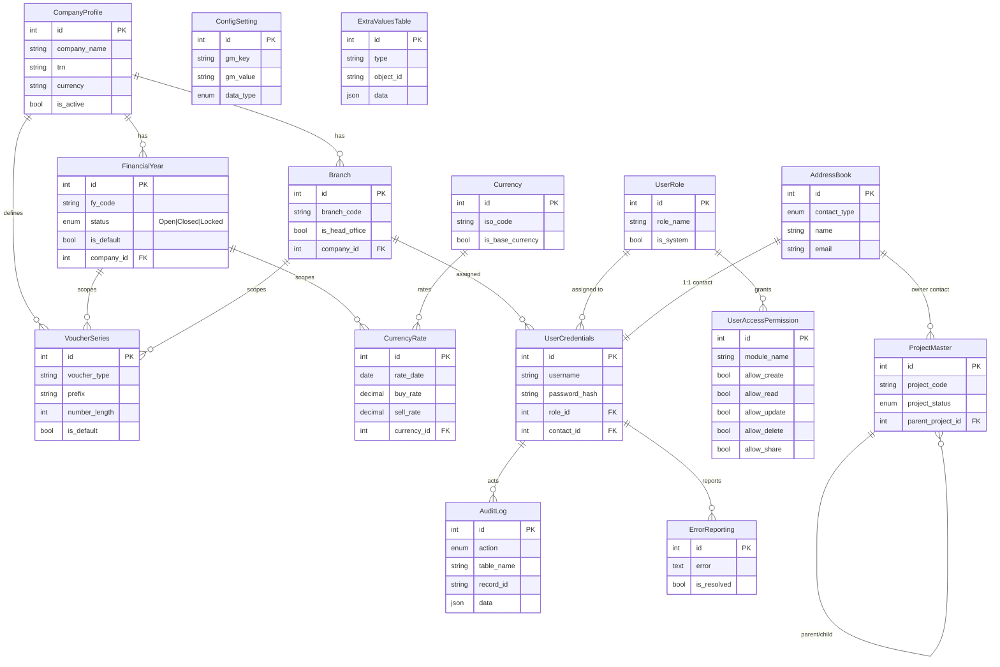
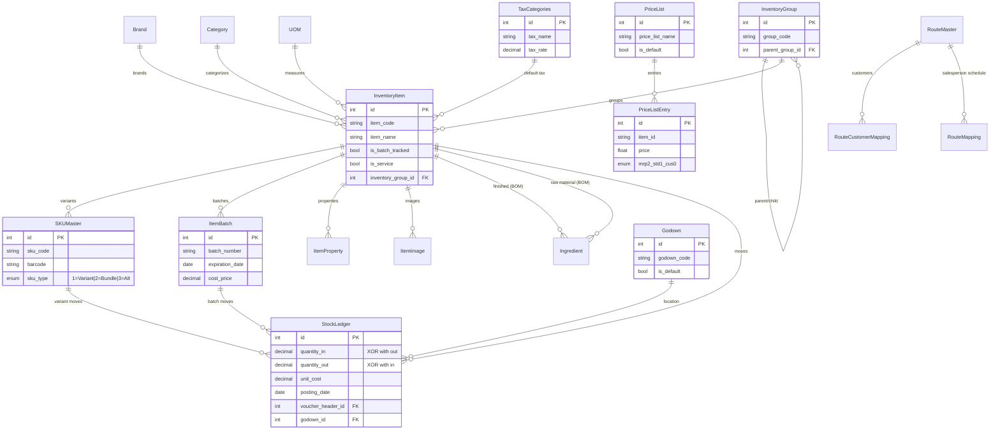
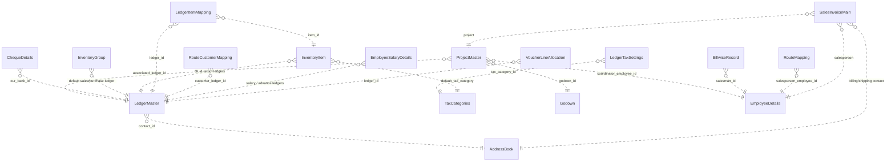

# algoERP — Entity Relationship Diagrams (Mermaid)

> Technology-neutral ER diagrams, split per domain for readability, plus a cross-module
> "soft FK" overview. Hard relationships (DB foreign keys / 1:1 shared-PK) are drawn with
> solid Mermaid relations; **application-enforced "soft FK" integer links** (no DB
> constraint) are listed separately in §6 and rendered as dotted relations where shown.
> Full attribute lists live in `BACKEND_CONTEXT.md`. Crow's-foot notation:
> `||--o{` = one-to-many, `||--||` = one-to-one, `}o--||` = many-to-one (optional).

---

## 1. Organization & System



---

## 2. Accounts

```mermaid
erDiagram
    AccountGroup ||--o{ AccountGroup       : "parent/child"
    AccountGroup ||--o{ LedgerMaster       : "classifies"
    LedgerMaster ||--o{ LedgerMaster       : "sub-ledger"
    LedgerMaster ||--|| LedgerBankDetails  : "1:1"
    LedgerMaster ||--|| LedgerCreditSettings : "1:1"
    LedgerMaster ||--|| LedgerTaxSettings   : "1:1"

    AccountGroup {
        int id PK
        string group_name
        enum nature "Assets|Liabilities|Income|Expense|Capital"
        enum group_behavior "Debit|Credit"
        bool is_system_defined
        int parent_group_id FK
    }
    LedgerMaster {
        int id PK
        string ledger_code
        string ledger_name
        enum ledger_type
        decimal opening_balance
        bool is_system_defined
        int account_group_id FK
        int parent_ledger_id FK
        int contact_id "soft FK -> address_book"
    }
    LedgerBankDetails {
        int ledger_id PK_FK
        string bank_account_number
        string iban
        string swift_code
    }
    LedgerCreditSettings {
        int ledger_id PK_FK
        int credit_period_days
        decimal credit_limit
    }
    LedgerTaxSettings {
        int ledger_id PK_FK
        string trn
        int tax_category_id "soft FK"
    }
    BillwiseRecord {
        int id PK
        enum ref_type
        decimal debit_amount
        decimal credit_amount
        date due_date
        string ledger_id "legacy string FK"
    }
    ChequeDetails {
        int id PK
        enum instrument_type
        string instrument_no
        bool is_cleared
        string ledger_id "legacy string FK"
    }
```

---

## 3. Inventory



---

## 4. Employee (HR)

```mermaid
erDiagram
    Department  ||--o{ Department  : "parent/child"
    Department  ||--o{ Designation : "has"
    Designation ||--o{ EmployeeDetails : "titled"
    Department  ||--o{ EmployeeDetails : "belongs"
    AddressBook ||--|| EmployeeDetails : "1:1 contact"

    EmployeeDetails ||--|| EmployeeBankDetails    : "1:1"
    EmployeeDetails ||--|| EmployeeSalaryDetails  : "1:1"
    EmployeeDetails ||--o{ EmployeeDocument       : "documents"
    EmployeeDetails ||--o{ SalaryRevisionHistory  : "revisions"
    EmployeeDetails ||--o{ LeaveAllocation        : "allocations"
    EmployeeDetails ||--o{ LeaveRequest           : "requests"
    EmployeeDetails ||--o{ AttendanceDetails      : "attendance"
    EmployeeDetails ||--o{ EmployeeShiftAssignment : "shifts"

    LeavePolicy ||--o{ LeaveAllocation : "governs"
    LeavePolicy ||--o{ LeaveRequest    : "type of"
    LeaveRequest ||--o{ AttendanceDetails : "links leave"
    ShiftMaster ||--o{ EmployeeShiftAssignment : "assigned"

    EmployeeDetails {
        int id PK
        string employee_code
        enum gender
        enum marital_status
        int contact_id FK
        int designation_id FK
        int department_id FK
    }
    EmployeeSalaryDetails {
        int employee_id PK_FK
        decimal basic_salary
        decimal hra
        int salary_ledger_id "soft FK"
    }
    EmployeeBankDetails {
        int employee_id PK_FK
        string account_number
        enum account_type
    }
    EmployeeDocument {
        int id PK
        enum doc_type
        date expiry_date
    }
    LeavePolicy {
        int id PK
        enum leave_type
        bool is_paid
    }
    LeaveRequest {
        int id PK
        date from_date
        date to_date
        enum status
    }
    AttendanceDetails {
        int id PK
        date working_date
        enum status
    }
    ShiftMaster {
        int id PK
        string shift_code
        bool is_night_shift
    }
```

---

## 5. Transactions (Vouchers)

```mermaid
erDiagram
    VoucherHeader ||--|| SalesInvoiceMain     : "1:1 (per type)"
    VoucherHeader ||--o{ SalesInvoiceDetail   : "lines"
    VoucherHeader ||--o{ JournalLedger        : "GL postings"
    VoucherHeader ||--o{ StockLedger          : "stock postings"
    VoucherHeader ||--|| Shipment             : "1:1 logistics"
    VoucherHeader ||--o{ VoucherLinkage       : "source links"
    VoucherHeader ||--o{ VoucherLinkage       : "target links"
    LedgerMaster  ||--o{ JournalLedger        : "posted to"
    TransactionHelper ||..|| VoucherHeader     : "numbers (lock)"

    VoucherHeader {
        int id PK
        enum voucher_type
        string voucher_prefix
        string voucher_no
        date voucher_date
    }
    TransactionHelper {
        int id PK
        string voucher_type
        string voucher_prefix
        string financial_year
        int last_number
        int number_length
        bool reset_yearly
    }
    SalesInvoiceMain {
        int voucher_header_id PK_FK
        enum voucher_status "Draft|Approved|Posted|Cancelled|Closed"
        decimal total
        decimal vat_amount
        int voucher_ledger_id FK
    }
    SalesInvoiceDetail {
        int id PK
        decimal quantity
        decimal price
        decimal tax_amount
        int item_id FK
    }
    JournalLedger {
        int id PK
        decimal debit_amount "XOR with credit"
        decimal credit_amount "XOR with debit"
        date posting_date
        int ledger_id FK
    }
    VoucherLineAllocation {
        int id PK
        enum allocation_type
        enum allocation_method
        decimal allocated_amount
        int detail_line_id "poly"
    }
    VoucherLinkage {
        int id PK
        enum link_type "Conversion|Reference|Return|Amendment"
        int source_voucher_id FK
        int target_voucher_id FK
    }
    VoucherLineRelation {
        int id PK
        string source_voucher_type
        string target_voucher_type
        decimal quantity_converted
    }
    Shipment {
        int id PK
        string carrier_name
        string lr_no
    }
```

> The 1:1 main + lines pattern shown for `SalesInvoiceMain`/`SalesInvoiceDetail` repeats
> for every voucher type (Quotation, SalesOrder, PurchaseInvoice, Payment, Receipt,
> GodownTransfer, Journal, PurchaseOrder, Credit/Debit Note, Delivery/Receipt Note, …).
> Ledger-based types (Payment/Receipt/Journal/Contra) use ledger+amount lines instead of
> item lines.

---

## 6. Cross-Module Soft-FK Overview

Application-enforced integer links **without** DB foreign-key constraints (dotted).
These are why the modules avoid hard circular dependencies.



> Note: GitHub/most renderers ignore the dotted `..` styling for `erDiagram` relations and
> draw them solid; the dotted intent is documentary — these links are **not** enforced by
> the database and must be validated by the application (see `BACKEND_CONTEXT.md` §11).
